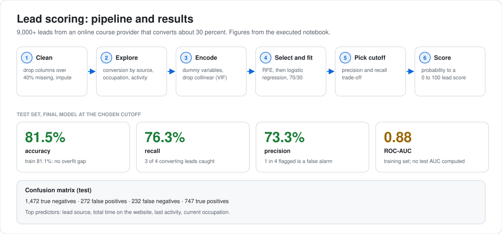

# Lead Scoring Case Study

**Building a logistic regression model to identify high-potential sales leads and improve conversion rates.**

**Author:** Karan Parekh

<p>
    
</p>

<picture>
  <source media="(prefers-color-scheme: dark)" srcset="assets/pipeline-results-dark.svg">
  
</picture>

---

## Problem Statement

X Education, an online course provider, acquires thousands of leads daily but converts only ~30%. The sales team wastes effort calling low-potential prospects. The goal: **build a lead scoring model** that assigns each lead a score from 0 to 100, enabling the sales team to focus on the "Hot Leads" most likely to convert.

---

## Approach

| Step | Description |
|------|------------|
| **Data Cleaning** | Handled missing values, removed columns with >40% nulls, imputed categorical features |
| **EDA** | Analyzed conversion rates across lead sources, occupations, and engagement metrics |
| **Feature Engineering** | Created dummy variables for categorical features, dropped redundant/multicollinear columns |
| **Model Building** | Logistic Regression with Recursive Feature Elimination (RFE) for feature selection |
| **Evaluation** | ROC-AUC, sensitivity/specificity curve, precision-recall tradeoff for cutoff selection |
| **Scoring** | Mapped predicted probabilities to lead scores from 0 to 100 |

---

## Key Results

Figures below come straight from the executed notebook.

- **Test set, final model at the precision-recall optimal cutoff: 81.5% accuracy, 76.3% recall, 73.3% precision**
- Test confusion matrix: 1,472 true negatives, 272 false positives, 232 false negatives, 747 true positives
- **ROC-AUC 0.88**, computed on the training set. A separate test-set AUC was not calculated in the notebook.
- Training accuracy 81.1% against test accuracy 81.5%, so there is no meaningful overfitting gap
- **Top predictors:** lead source, total time spent on website, last activity type, current occupation
- **Business read:** at this cutoff the model catches roughly three out of four leads that actually convert, while about one in four flagged leads is a false alarm

---

## Tech Stack

`Python` · `Pandas` · `NumPy` · `Matplotlib` · `Seaborn` · `Scikit-learn` · `Statsmodels` · `Logistic Regression` · `RFE`

---

## Repository Structure

```
├── Lead Score Case Study_Karan Parekh.ipynb   # Full analysis notebook
├── Leads.csv                                   # Dataset (9,000+ leads)
├── Assignment Subjective Questions.pdf          # Business questions answered
├── Summary.pdf                                  # Executive summary of findings
└── README.md
```

---

## How to Run

```bash
git clone https://github.com/karanparekh14/Lead-Score-Case-Study.git
cd Lead-Score-Case-Study
pip install pandas numpy matplotlib seaborn scikit-learn statsmodels
jupyter notebook "Lead Score Case Study_Karan Parekh.ipynb"
```
